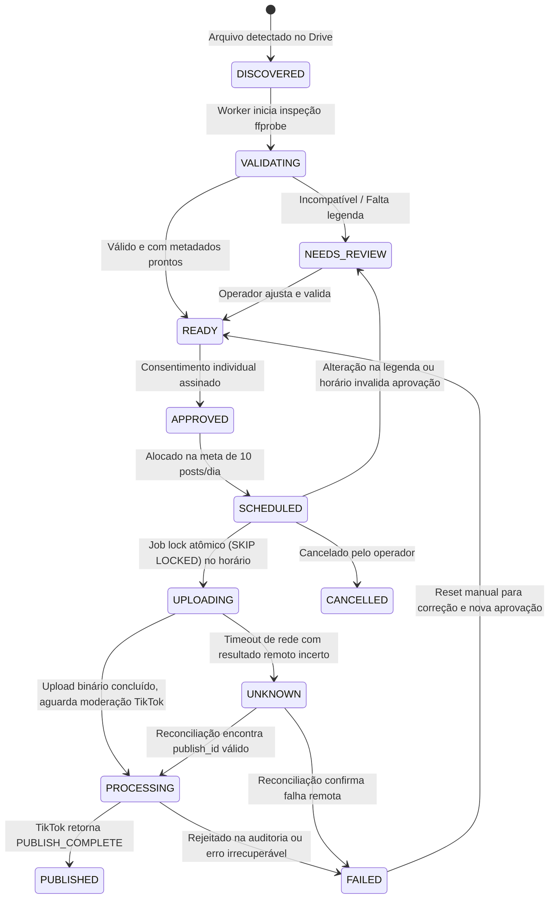

# Arquitetura e Máquina de Estados do Focus Publisher

## 1. Visão Geral da Arquitetura

O **Focus Publisher** é estruturado como um monólito modular assíncrono em Python 3.12, combinando FastAPI para a interface administrativa e Celery + Redis + PostgreSQL para processamento confiável de fila e agendamento.

```
                           +------------------------+
                           |  Google Drive Folder   |
                           +-----------+------------+
                                       |
                                       v [Drive Sync Service]
+--------------------------------------+--------------------------------------+
|                           FOCUS PUBLISHER MONOLITH                          |
|                                                                             |
|  +--------------------+   +---------------------+   +--------------------+  |
|  |   FastAPI Admin    |   | Celery Worker Tasks |   | Celery Beat Sched  |  |
|  |  (HTMX / Jinja2)   |   | (Sync/Pub/Reconcile)|   | (Periodic 1min tick|  |
|  +---------+----------+   +----------+----------+   +---------+----------+  |
|            |                         |                        |             |
|            +-------------------------+------------------------+             |
|                                      |                                      |
|                       +--------------v---------------+                      |
|                       |   PostgreSQL Source of Truth |                      |
|                       | (ACID, Locks, Audit Log, UTC)|                      |
|                       +--------------+---------------+                      |
+--------------------------------------+--------------------------------------+
                                       |
                   +-------------------+-------------------+
                   |                                       |
                   v                                       v
    +-----------------------------+        +------------------------------+
    |  TikTok Content Posting API |        | Pacote Manual TikTok Studio  |
    | (DIRECT_POST via OAuth v2)  |        | (CSV + Vídeos + Legendas)    |
    +-----------------------------+        +------------------------------+
```

---

## 2. Máquina de Estados de Publicação

Cada item no ciclo de vida passa por transições controladas e auditadas:



### Detalhamento dos Estados:

| Estado | Significado Técnico |
| :--- | :--- |
| `DISCOVERED` | Arquivo listado via Google Drive API com ID, tamanho e SHA-256 inicial. |
| `VALIDATING` | Em inspeção técnica com ffprobe (codec, resolução, duração, áudio). |
| `NEEDS_REVIEW` | Necessita de atenção humana (ex: proporção não-vertical, duração fora do padrão, legenda vazia). |
| `READY` | Arquivo atende aos critérios técnicos e rascunho de legenda/hashtags preenchido. |
| `APPROVED` | Operador revisou parâmetros de privacidade e consentiu explicitamente. Hash criptográfico gerado. |
| `SCHEDULED` | Distribuído em um dos 10 horários do calendário diário em `America/Fortaleza`. |
| `UPLOADING` | Lock exclusivo adquirido pelo Celery Worker (`SELECT FOR UPDATE SKIP LOCKED`). Binário sendo enviado. |
| `PROCESSING` | `publish_id` emitido pela API TikTok; em processamento e auditoria assíncrona. |
| `PUBLISHED` | Confirmação formal via `/v2/post/publish/status/fetch/` com status `PUBLISH_COMPLETE`. |
| `FAILED` | Erro não recuperável durante envio ou rejeição na moderação do TikTok. |
| `BLOCKED` | Bloqueio por falta de autorização OAuth, conta suspensa ou quota atingida. |
| `CANCELLED` | Post retirado do calendário pelo operador antes do envio. |
| `UNKNOWN` | Falha de conectividade ou timeout pós-envio. Entra em quarentena de reconciliação. |

---

## 3. Concorrência e Reserva Atômica

Para impedir que dois workers executem o mesmo post em paralelo:
1. **Reserva Atômica no Banco de Dados:**
   ```sql
   SELECT id, post_draft_id, scheduled_time_utc
   FROM scheduled_posts
   WHERE status = 'SCHEDULED'
     AND scheduled_time_utc <= :now_utc
     AND (locked_at IS NULL OR locked_at < :lock_timeout_utc)
   ORDER BY scheduled_time_utc ASC
   LIMIT 10
   FOR UPDATE SKIP LOCKED;
   ```
2. Ao selecionar o registro, o worker imediatamente atualiza `status = 'UPLOADING'`, `lock_id = :worker_uuid` e `locked_at = :current_timestamp`.
3. Nenhum outro worker concorrente processará o mesmo post.

---

## 4. Política Anti-Spam e Recuperação de Indisponibilidade

Se a infraestrutura passar 4 horas desligada e houver 3 posts atrasados:
* **NUNCA disparar todos em rajada:** Disparar múltiplos vídeos em sequência viola os limites de spam do TikTok e pode resultar em shadowban ou suspensão da conta.
* **Tolerância Configurável (Padrão: 15 minutos):**
  * Posts atrasados dentro da tolerância são executados normalmente com espaçamento mínimo.
  * Posts com atraso superior à tolerância são marcados como `NEEDS_REVIEW` e reagendados para os próximos slots livres do calendário, com alerta explícito exibido no painel administrativo.
